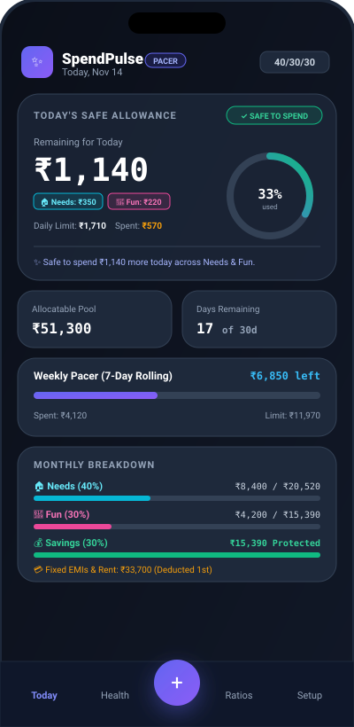
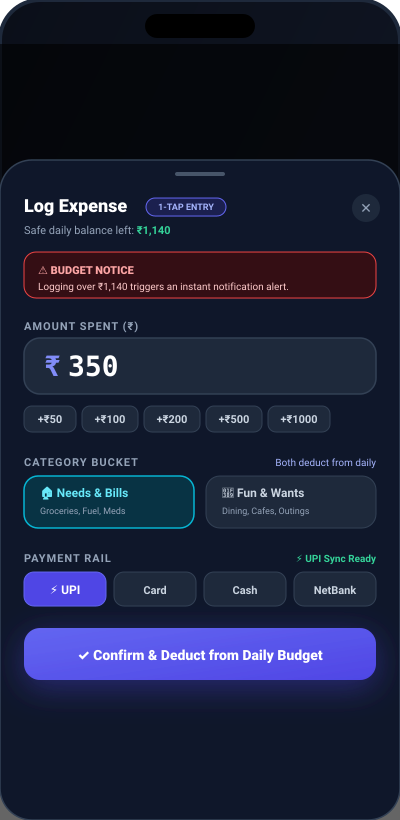

# SpendPulse 💳 - Smart Daily & Weekly Expense Budgeting App

[](https://react.dev/)
[](https://www.typescriptlang.org/)
[](https://tailwindcss.com/)
[](https://capacitorjs.com/)
[](https://opensource.org/licenses/MIT)

> **SpendPulse** converts your monthly lump-sum income into an active, safe-to-spend **Daily & Weekly Allowance**, adapting automatically as you spend so you never run out of money before month's end.

---

## 📱 App Previews & Screenshots

<p align="center">
  
  
</p>


---

## 🌟 Why SpendPulse?

Traditional monthly budgets fail because lump sums (e.g., ₹85,000 or $4,000) look large during the first two weeks of the month, leading to rapid overspending. 

**SpendPulse solves this with a Dynamic Pacing Engine**:
1. **Deducts Fixed Obligations First**: Loans, EMIs, House Rent, and Insurance are protected upfront.
2. **Custom Ratio Engine**: Splits your disposable income into customizable buckets (e.g. **40% Needs**, **30% Fun**, **30% Savings**) with 100% balance validation.
3. **Safe-to-Spend Daily & Weekly Allowance**: Calculates your exact spending limit for today across daily expenses (**Needs + Fun**).
4. **Smart Rolling Recalculation**:
   * *Spend less today?* Leftover funds increase future daily allowances or flow into your savings piggy bank.
   * *Overspend today?* The pacer dynamically adjusts subsequent days to protect your monthly savings goal.
5. **Real-Time Over-Budget Alerts**: In-app banners, device vibrations, and OS-level system notifications alert you whenever an expense exceeds your daily threshold.
6. **100% Offline & Private**: Zero external servers track your finances. Complete JSON backup export and restore built-in.

---

## 🚀 Quick Start (Web Application)

### Prerequisites
* [Node.js](https://nodejs.org/) (v18 or newer)
* npm or pnpm

### 1. Clone & Install
```bash
git clone https://github.com/YOUR_USERNAME/spendpulse.git
cd spendpulse
npm install
```

### 2. Run Locally in Development
```bash
npm run dev
```
Open **`http://localhost:5173`** in your browser.
* On desktop: Enjoy the responsive smartphone preview shell (toggle between Phone Frame and Full Screen).
* On mobile: Experience native edge-to-edge touch UI.

### 3. Production Build
```bash
npm run build
```

---

## 🤖 Android Native Setup (APK & Google Play Store)

SpendPulse is configured with **Capacitor 7** for Android.

### 1. Sync Production Code to Android
```powershell
npm run build
npx cap sync
```

### 2. Run or Test on Android Device
```powershell
npx cap open android
```
In Android Studio:
* Plug in your Android device with **USB Debugging** enabled.
* Click the green **Play (Run)** button ▶️.
* Or generate a test APK via: **Build > Build Bundle(s) / APK(s) > Build APK(s)**.

### 3. Build Signed Release Bundle (`.aab`) for Google Play
1. In Android Studio, click **Build > Generate Signed Bundle / APK**.
2. Select **Android App Bundle** (`.aab`).
3. Choose your Keystore and select the **Release** build variant.
4. Output `.aab` file will be generated in `android/app/release/app-release.aab` ready for Google Play Console upload!

---

## 🍏 iOS Setup (iPhone)

### Method A: Instant Test on iPhone (Zero Mac Needed — 30 Seconds)
1. Run with host enabled on your computer:
   ```bash
   npm run dev -- --host
   ```
2. Open `http://<YOUR_PC_IP>:5173` in **Safari** on your iPhone.
3. Tap **Share > Add to Home Screen**. The app installs full-screen with native gestures and offline support.

### Method B: Native iOS Xcode Build (Requires macOS)
```bash
npm run build
npx cap sync
npx cap open ios
```
In Xcode, sign with your free personal Apple ID and click **Run** to install natively onto your connected iPhone.

---

## ⚡ Future UPI & Banking Automation Schema

SpendPulse's transaction data model (`src/types/budget.ts`) is pre-architected with:
* `paymentMethod: 'UPI' | 'Card' | 'Cash' | 'NetBanking'`
* `referenceNumber`: Unique transaction/UPI reference identifier.
* `category`: Automated keyword mapping (groceries, dining, transit).

When compiled to native Android, a background Notification/SMS listener hook can read incoming GPay, PhonePe, Paytm, or bank debit alerts and log transactions automatically!

---

## 🛠️ Tech Stack

* **UI Framework**: React 18 / TypeScript
* **Styling**: Tailwind CSS, Glassmorphism, Inter & JetBrains Mono typography
* **Icons & Polish**: Lucide React, Canvas Confetti
* **Mobile Runtime**: Capacitor.js (Android & iOS)
* **Storage**: Local-first IndexedDB / LocalStorage with JSON backup export

---

## 📄 License

This project is licensed under the [MIT License](LICENSE).
